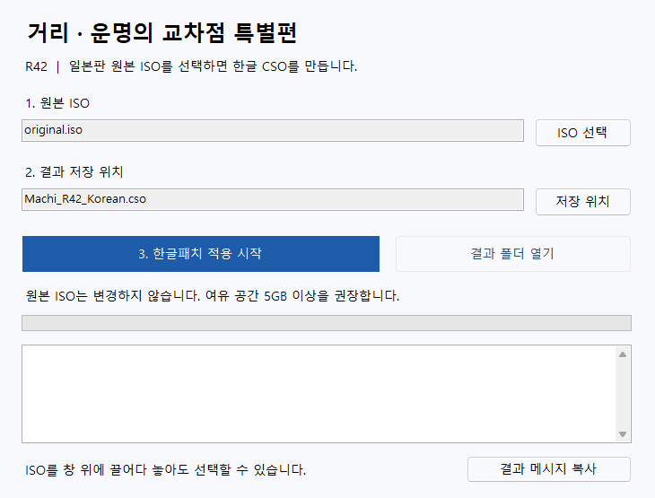
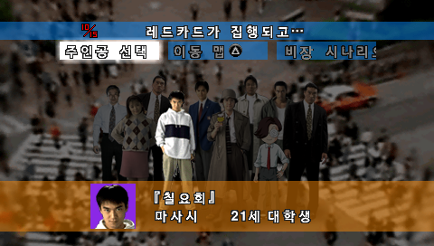
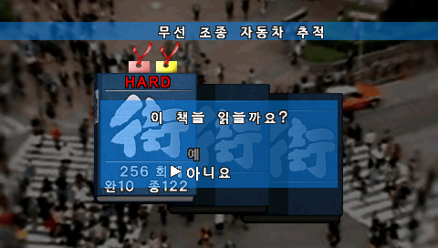

# 거리 · 운명의 교차점 특별편 — PSP 한글패치

PSP 일본판 《街 ～運命の交差点～ 特別篇》의 비공식 한글패치입니다.
본문과 TIP, 메뉴를 번역하고 일부 그래픽과 동영상의 일본어 문구를 한글로 바꿨습니다.

게임 버전은 R42입니다. 간편 적용판은 적용 프로그램과 설명을 개선한 배포본으로, 완성되는 게임은 기존 R42와 같습니다. 이미 정상 적용한 분은 다시 만들 필요가 없습니다.

## 다운로드

**[간편 적용판 받기](https://github.com/ayaneros-eng/machi-psp-korean-patch/releases/latest)**

| 상황 | 받을 파일 |
| --- | --- |
| 처음 받거나 무엇을 받을지 모르겠다면 | `Machi_PSP_Korean_R42_Easy.zip` |
| 이전 `Machi_PSP_Korean_R42.zip`을 이미 받아 압축을 풀었다면 | `Machi_R42_Launcher_Update.zip` |

Windows 10/11 64비트용입니다. 필요한 실행 환경을 포함하므로 Python을 따로 설치하거나 PATH를 설정할 필요가 없습니다. 인터넷 연결도 다운로드할 때만 필요합니다.

자동 생성되는 `Source code` 파일에는 패치 데이터와 실행 환경이 없습니다. 위 표의 ZIP을 선택하세요. 일본판 원본 ISO는 직접 준비해야 하며, 게임 이미지는 배포하지 않습니다.

## 가장 쉬운 적용 방법

1. `Machi_PSP_Korean_R42_Easy.zip`을 마우스 오른쪽 버튼으로 누르고 **모두 추출** 또는 **압축 풀기**를 선택합니다. ZIP 안에서 바로 실행하지 마세요.
2. 압축을 푼 폴더에서 `MachiPatch.exe`를 더블클릭합니다.
3. **ISO 선택**을 눌러 일본판 원본 ISO를 고릅니다. 필요하면 **저장 위치**를 바꿉니다.
4. **한글패치 적용 시작**을 누릅니다. 적용과 검증이 끝나면 `Machi_R42_Korean.cso`가 만들어집니다.



원본 ISO는 변경하지 않습니다. 여유 공간은 5GB 이상을 권장합니다. 같은 이름의 다른 파일은 덮어쓰지 않으며, 정상적인 R42 결과가 이미 있으면 확인 완료로 안내합니다.

`MachiPatch.exe`만 다른 곳으로 옮기지 마세요. `runtime` 폴더와 나머지 파일을 함께 두어야 합니다. 내부의 `Machi_ORIGINAL_JP_to_R42.patch.zip`은 압축을 풀지 않고 그대로 둡니다.

## 기존 CMD 끌어놓기 방식

원본 ISO를 이 배포 폴더의 `apply_patch.cmd` 위에 끌어다 놓으면 적용창이 열리고 ISO가 선택됩니다. **한글패치 적용 시작**을 누르면 됩니다. CMD를 더블클릭한 뒤 창에서 ISO를 선택해도 됩니다.

이전 배포본은 `py -3.11` 명령에만 의존해 Python이 설치되어 있어도 실행되지 않는 경우가 있었습니다. 새 CMD는 전용 적용창을 먼저 열며, 적용창이 없는 경우에는 포함된 Python과 설치된 Python을 찾아 실행합니다. 실패하면 오류 안내를 남기고 창을 유지합니다.

### 이전 배포 파일을 이미 받은 경우

1. `Machi_R42_Launcher_Update.zip`을 받습니다.
2. 이전 한글패치의 압축을 풀었던 폴더에 업데이트 ZIP을 풀고, 같은 이름의 적용 도구·설명 파일을 교체합니다.
3. `MachiPatch.exe`를 실행합니다. 기존 `.patch.zip` 데이터는 그대로 사용합니다.

업데이트 ZIP에는 패치 데이터가 없습니다. 이전 파일이 없으면 간편 적용판 전체 ZIP을 받으세요.

## 잘 안 될 때

| 증상·오류 코드 | 확인할 내용 |
| --- | --- |
| 실행 환경 없음, 실행 파일·데이터 누락 | ZIP 전체를 새 폴더에 풀었는지 확인하세요. `Source code`를 받았다면 간편 적용판으로 다시 받으세요. |
| `ISO_SIZE` | 원본 ISO 크기가 다릅니다. 일본판 ULJM-05111, 1,542,422,528바이트가 대상입니다. |
| `ISO_HASH` | 크기는 같지만 내용이 다른 원본입니다. 아래 SHA-256과 비교하세요. |
| `OUTPUT_EXISTS` | 같은 이름의 다른 결과 파일이 있습니다. 저장 위치에서 새 이름을 지정하세요. 이전 실패 파일일 수도 있습니다. |
| `SPACE` | 여유 공간을 확보하거나 다른 드라이브에 저장하세요. |
| `PERMISSION` | 문서·다운로드 등 쓰기 가능한 폴더를 선택하고 파일을 사용하는 다른 프로그램을 확인하세요. |
| `PATCH_ZIP`, `PATCH_DATA` | 다운로드한 파일이 손상됐을 수 있습니다. ZIP을 다시 받아 새 폴더에 풀어 주세요. |
| `RUNTIME`, `START` | 간편 적용판의 `runtime` 폴더를 함께 두었는지, Windows 10/11 64비트인지 확인하세요. |

CSO, 다른 판본, 이미 한글패치를 적용한 ISO는 입력으로 사용할 수 없습니다. 원본 해시 불일치는 파일명을 바꾸거나 Python을 재설치해도 해결되지 않습니다.

보안 프로그램이 차단했다면 배포 출처와 파일 해시를 확인하고, 문의할 때 차단 메시지도 함께 알려 주세요.

오류가 계속되면 적용창의 **결과 메시지 복사**로 표시된 오류를 [Issues](https://github.com/ayaneros-eng/machi-psp-korean-patch/issues)에 남겨 주세요.

## 지원 원본과 결과

| 항목 | 원본 | 적용 결과 |
| --- | --- | --- |
| 형식 | 압축하지 않은 일본판 ISO | 한글 CSO |
| 제품 번호 | ULJM-05111 | ULJM-05111 |
| 크기 | 1,542,422,528바이트 | 1,712,404,852바이트 |

원본 ISO SHA-256:

```text
48C5DF78FA7EBDDFB80DBC249BE211DB759678539976B8B45A9D9972A565488F
```

완성 CSO SHA-256:

```text
8FEFB36146E179B1A02343448C7A110DCD069413E079AAD9A8BD4CE661A7A650
```

파일명은 달라도 됩니다. 적용 도구가 원본과 결과를 자동으로 검사합니다.

## 한글 화면

| 타이틀 | 본문 |
| --- | --- |
|  |  |
| 주인공 선택 | 불러오기 |
|  |  |

## 현재 버전에서 알아둘 점

- 일부 화면은 글꼴의 크기·두께·간격이 완전히 통일되지 않았습니다. 추가 정리는 후속 작업으로 남겨 두었습니다.
- 일본어 글자의 위치나 모양이 풀이에 필요한 암호는 원문을 유지하고 한글 설명을 보완했습니다.
- 크레딧과 마지막 회상 몽타주의 일본어는 원문을 유지했습니다. 배경 속 간판 등 일부 일본어도 남아 있습니다.
- 화면과 진행 검수는 PPSSPP에서 했습니다. PSP 본체에서의 동작은 별도로 검증하지 않았습니다.

오탈자나 화면 잘림을 발견하면 주인공·날짜·장면과 화면샷을 알려 주세요. 결말에 관한 내용은 제목에 스포일러 표시를 부탁드립니다.

<details>
<summary>명령줄로 직접 적용하기</summary>

간편 적용판의 압축을 푼 폴더에서 PowerShell을 열고 실행합니다.

```powershell
.\runtime\python.exe -I -B -X utf8 .\apply_patch.py --source "original.iso" --output "Machi_R42_Korean.cso"
```

`original.iso`를 원본 ISO의 경로로 바꾸세요. Python을 직접 설치하여 사용할 경우에는 [Python 3.11.9 Windows installer (64-bit)](https://www.python.org/downloads/release/python-3119/)와 Python Launcher를 설치한 뒤 다음 명령을 사용할 수 있습니다.

```powershell
py -3.11 -I -B -X utf8 .\apply_patch.py --source "original.iso" --output "Machi_R42_Korean.cso"
```

검증한 실행 환경은 Python 3.11.9 / zlib 1.3.1 / 64비트입니다. 호환되지 않는 환경은 적용 전에 안내합니다. 일반 사용은 별도 설치가 없는 간편 적용창을 권장합니다.

</details>

포함된 Python의 출처와 라이선스는 [THIRD_PARTY_NOTICES.txt](THIRD_PARTY_NOTICES.txt)에 정리했습니다. 원작의 저작권은 각 권리자에게 있습니다.
